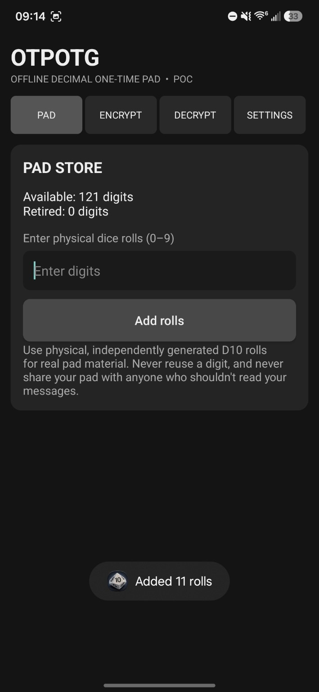
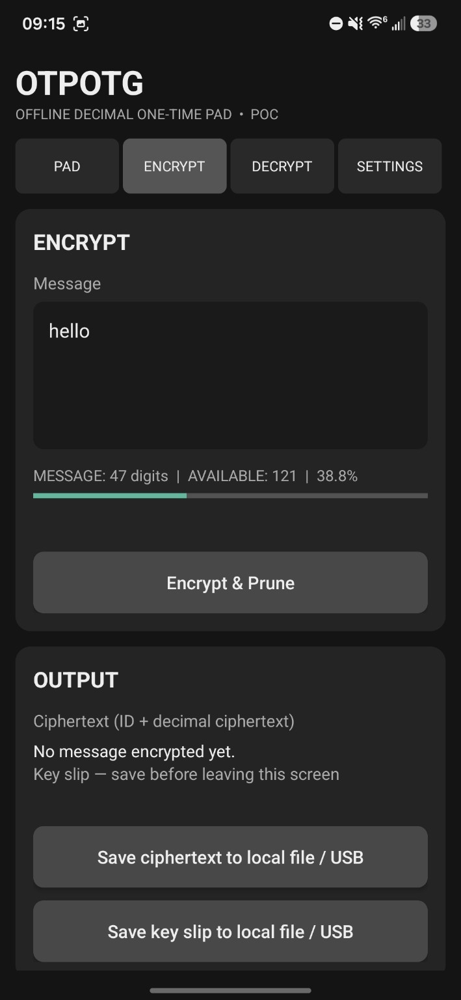
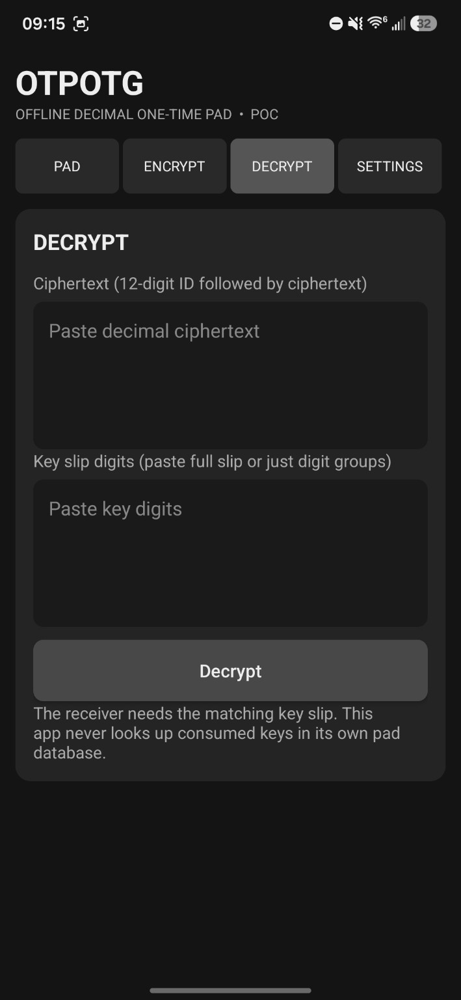
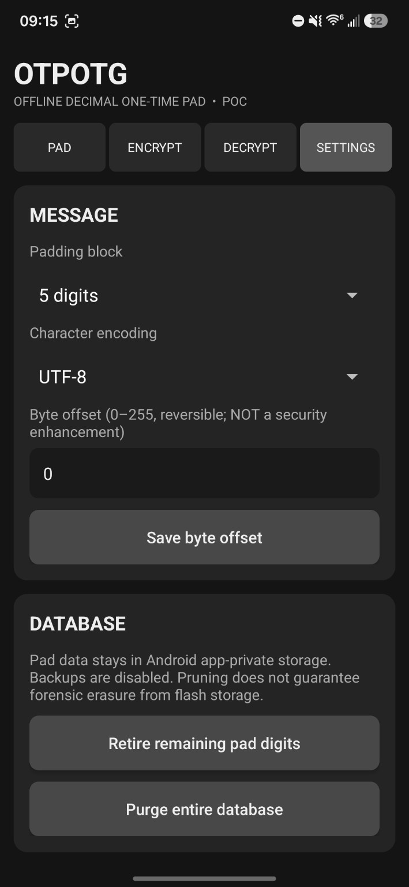

# OTPOTG

**Offline, dice-powered one-time-pad messaging for Android.**

OTPOTG is a free and open-source Android application from **NoRec** that takes the arithmetic and formatting work out of using a decimal one-time pad. You supply the pad digits—ideally by rolling a physical ten-sided die—and OTPOTG handles message encoding, digit-wise encryption and decryption, and local pad bookkeeping.

No accounts. No servers. No network permission. No automatic key generation for real-world use.

> [!WARNING]
> **Experimental software — not independently security audited. Do not rely on OTPOTG to protect important secrets.** One-time pads are unforgiving: biased, disclosed, or reused pad material can compromise confidentiality. The current implementation also has operational limitations described below.

## What it does

- **Manual pad entry:** Record decimal digits obtained from physical D10 rolls.
- **Encrypt & Prune:** Encode plaintext, encrypt it with pad digits, and remove consumed digits from the locally stored pad.
- **Key-slip decryption:** Decrypt a message using its matching key slip, without needing the sender's pad database.
- **Local exports:** Save ciphertext and key slips using Android's document picker.
- **Configurable encoding:** UTF-8, ASCII, and Latin-1 options; configurable byte offsets and padding blocks.
- **Legacy compatibility:** Supports the V2 decimal format and decryption of supported older V1/DEC3 formats from the desktop DICE / OTP project.
- **Local diagnostics:** Offline self-tests and synthetic digits for development and demonstrations.
- **Offline by design:** No `INTERNET` permission, analytics, advertising SDKs, accounts, or cloud synchronization.

## Screenshots

A look at OTPOTG running on Android. These screenshots show the early proof-of-concept interface, not a final security-audited release.

| Pad Store | Encrypt |
|:---:|:---:|
|  |  |
| **Decrypt** | **Settings** |
|  |  |

The screenshots are also included in `fastlane/metadata/android/en-US/images/phoneScreenshots/` for future F-Droid listing metadata. They contain demonstration UI only; do not publish screenshots showing actual secret pad material or key slips.

## How the dice-based workflow works

1. **Generate your pad outside the app.** Roll a ten-sided die and record each result as one decimal digit (`0`–`9`). For real OTP use, the digits must be independent, uniformly distributed, and kept secret.
2. **Enter the digits.** OTPOTG stores the entered pad in Android app-private storage.
3. **Encrypt a message.** OTPOTG converts the message into its decimal representation, applies padding, and combines each encoded digit with a pad digit using addition modulo 10. It also consumes a 12-digit message identifier from the pad.
4. **Export both outputs.** Save the ciphertext for delivery and the corresponding key slip for the intended recipient, using appropriately secure *separate* arrangements.
5. **Decrypt.** The recipient uses the matching key slip to reverse the digit-wise operation and recover the text.

**Important:** The app does **not** arrange secure delivery of pads or key slips. Never send the key slip alongside its ciphertext over the same exposed channel and assume the message remains secret. For two-way messaging, use separate directional pad allocations. Never encrypt two messages with the same pad digits.

### A tiny decimal example

For three already-encoded digits:

```text
Encoded digits:  123
Pad digits:      789
Ciphertext:      802   (addition modulo 10, digit by digit)
Recovered:       123   (subtraction modulo 10)
```

This illustrates the arithmetic only. Real OTPOTG messages include format metadata, a message identifier, and padding.

## Current development status

**Early proof of concept (POC).** The app has been built and run during development, but it has **not** undergone an independent cryptographic or security audit and is **not yet published on F-Droid**.

The standalone core test suite contains **40 tests**; Android also provides a local self-test. Passing round-trip tests does not establish cryptographic security.

### Known limitations and security considerations

- **Crash-sensitive key slips:** Encryption consumes and persists pad digits before the user has necessarily exported the key slip. A crash or restart at the wrong moment can leave a ciphertext impossible to decrypt. A crash-safe consumption/export workflow is a release priority.
- **No authentication:** Decimal OTP encryption does not authenticate messages or prevent undetected ciphertext modification.
- **Pad storage:** Pad digits and key slips are sensitive. App-private storage is not protection against a compromised or rooted device. Exported files are controlled by their destination and may be exposed by other apps or backups.
- **Flash deletion:** Pruning or deleting stored digits does not guarantee forensic erasure from flash memory.
- **No synchronization:** OTPOTG does not sync pad allocations between devices. The user is responsible for safe distribution and preventing reuse.
- **Synthetic test data:** Development-generated digits are **not** a substitute for independently generated physical randomness. Never use them for real secrets.
- **Database compatibility:** Desktop ciphertext/key-slip format compatibility does **not** mean the desktop JSON pad database can be imported. This POC does not include a pad-database import/export UI.

## Build from source

### Requirements

- Android Studio and Android SDK Platform **35**
- **JDK 17** (for this project's Gradle 8.9 / Android Gradle Plugin 8.7.3 toolchain)
- Gradle **8.9**, using the repository's Gradle wrapper
- Windows, Linux, or macOS for normal Android development

The app targets Android API 34, compiles against API 35, and supports **Android 8.0 (API 26) and later**.

Clone the repository and open its root directory in Android Studio, or build from a terminal:

**Windows (PowerShell):**

```powershell
.\gradlew.bat :app:assembleDebug --console=plain
```

**Linux / macOS:**

```bash
./gradlew :app:assembleDebug --console=plain
```

The debug APK is generated at:

```text
app/build/outputs/apk/debug/app-debug.apk
```

You can install it on a test phone with Android Debug Bridge (`adb install -r <path-to-apk>`) or transfer the APK and sideload it. A debug APK is intended for development; it is not a reproducible, signed F-Droid release.

> The Gradle wrapper scripts, wrapper properties, and `gradle/wrapper/gradle-wrapper.jar` must all be present in a complete Git checkout. Do not commit `local.properties`, build outputs, signing keys, or private pad data.

### Run the standalone core tests

**Windows (PowerShell):**

```powershell
New-Item -ItemType Directory -Force core-tests/classes | Out-Null
javac -d core-tests/classes app/src/main/java/us/norec/otpotg/OtpCore.java core-tests/CoreSmokeTest.java
java -cp core-tests/classes CoreSmokeTest
```

**Linux / macOS:**

```bash
mkdir -p core-tests/classes
javac -d core-tests/classes app/src/main/java/us/norec/otpotg/OtpCore.java core-tests/CoreSmokeTest.java
java -cp core-tests/classes CoreSmokeTest
```

### LAD — Lazy Ass Developer (Windows)

Windows developers can launch `Launch-LAD.cmd` for a PowerShell/WinForms interface to check the environment, run core tests, inspect F-Droid readiness, build APKs, and read device logs. See [LAD-README.md](LAD-README.md). LAD is a local development utility; it is **not included in the Android APK**.

## Project layout

```text
app/                 Android application and launcher icons
core-tests/          Standalone Java OTP core tests
docs/F-DROID.md      F-Droid preparation checklist
fastlane/            Android store-listing metadata
gradle/              Gradle wrapper configuration
LAD.ps1              Windows developer helper
Launch-LAD.cmd       LAD launcher
LICENSE              GPLv3 license text
```

## Privacy and permissions

OTPOTG does not request Android's `INTERNET` permission and does not contain application networking, advertising, or telemetry code. Automatic Android app backup is disabled in the manifest. **That does not mean the operating system, file picker, or external document destinations are inherently private.** Inspect where sensitive material is exported and how that destination handles backups and sharing.

Gradle may download build dependencies on your development computer; that is separate from networking by the installed Android app.

## F-Droid roadmap

The goal is publication through [F-Droid](https://f-droid.org/). Before submission, the project needs a public, tagged, buildable source release; complete and verified Gradle wrapper; appropriate metadata/screenshots; dependency and permission review; real-device testing; and resolution of key-slip crash-safety concerns. See [docs/F-DROID.md](docs/F-DROID.md) for the current checklist.

**Being open source or hosted on GitHub does not mean F-Droid has approved or listed the app.**

## Contributing

Issues and pull requests are welcome, especially for format compatibility, test coverage, accessibility, Android compatibility, and safer pad-consumption handling. Please avoid attaching real pad material, key slips, private messages, or sensitive device logs to public issues.

See [CONTRIBUTORS.md](CONTRIBUTORS.md) for contributor information.

## License

**GPL-3.0-or-later** — GNU General Public License, version 3 or (at your option) any later version. See [LICENSE](LICENSE).

Copyright and contributor notices should be preserved in redistributed versions.

---

**NoRec · OTPOTG**  
*Your dice. Your pad. Your responsibility.*
